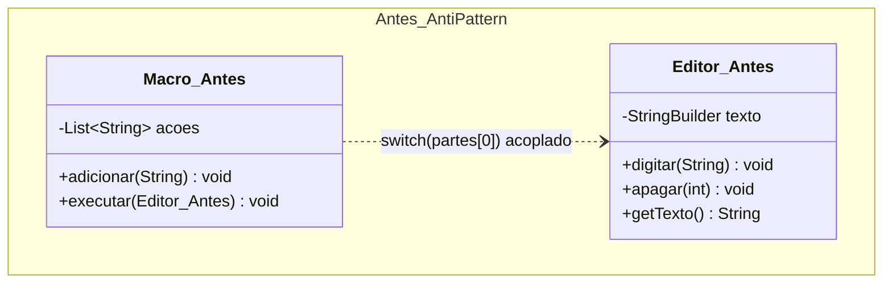
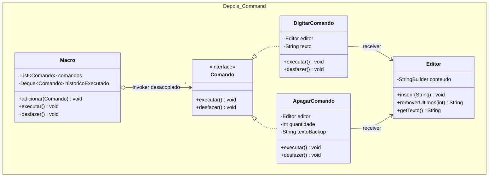

# Atividade 17: Command

## Exercício 1: Aplicações

1. **Faz sentido usar Command.** Transformar cada ação de botão em um objeto `Comando` desacopla a barra de ferramentas visual (*Invoker*) das operações do documento (*Receiver*). Além disso, armazenar a pilha de comandos executados torna imediata a implementação de desfazer/refazer (`undo`/`redo`).
2. **Faz sentido usar Command.** Encapsular cada tarefa (*job*) com seus parâmetros em um objeto de comando permite colocá-la em uma fila, serializá-la, agendar sua execução para outro momento ou cancelá-la antes do disparo sem que o agendador conheça a regra de negócio interna de cada job.
3. **Faz sentido usar Command.** Uma macro é uma composição de comandos (Composite Command) em que várias requisições encapsuladas são armazenadas em uma lista e disparadas em sequência (ou revertidas na ordem inversa) por meio da mesma interface `Comando`.
4. **Não faz sentido usar Command.** Uma geração de PDF direta, síncrona, sem fila, sem parametrização dinâmica de ações e sem operação de reversão não ganha nada ao ser encapsulada em objetos de comando (*overengineering*).
5. **Não faz sentido usar Command.** Somar coordenadas em uma classe `Ponto` sem requisito de histórico de ações, fila ou *undo* é resolvido diretamente por um método simples na própria classe.

---

## Exercício 2: Rastreando o anti-pattern em um projeto real

### Respostas às Questões de Análise

1. **Acoplamento forte no `switch (partes[0])` da `Macro`:** O invocador (`Macro`) precisa fazer *parsing* de texto, conhecer o nome de todas as operações existentes e chamar diretamente os métodos específicos do `Editor`. Ao adicionar a operação `SUBSTITUIR`, somos obrigados a modificar a classe `Macro` para incluir um novo `case "SUBSTITUIR"`, violando o Princípio Aberto-Fechado (OCP) e misturando lógica de orquestração com regras de edição.
2. **Problemas de representar ações como strings (`"DIGITAR:Ola"`):** Não há verificação de tipos nem validação em tempo de compilação. Erros de digitação no nome do comando (`"DIGITA:Ola"`), ausência do delimitador `:` ou parâmetros numéricos inválidos (ex.: `"APAGAR:abc"`) só falham em tempo de execução (`ArrayIndexOutOfBoundsException`, `NumberFormatException`) ou são ignorados silenciosamente.
3. **Por que não é possível desfazer a macro no código original:** As strings guardam apenas a intenção de entrada, mas descartam o estado afetado durante a execução (por exemplo, ao executar `"APAGAR:3"`, os 3 caracteres removidos do `Editor` são perdidos para sempre). Para reverter cada passo, cada comando precisa ser um objeto com estado próprio capaz de guardar o trecho apagado (ou o tamanho inserido) e implementar o método `desfazer()` executado na ordem inversa (LIFO).
4. **Estrutura da refatoração com Command:**
   - **Interface `Comando`:** Declara `executar()` e `desfazer()`.
   - **Receiver (`Editor`):** Contém o `StringBuilder` do texto e executa as operações reais de inserir e remover caracteres.
   - **Comandos concretos:** `DigitarComando` (guarda o texto inserido para removê-lo no `desfazer()`) e `ApagarComando` (guarda a substring exata removida durante o `executar()` para restaurá-la no `desfazer()`).
   - **Invoker (`Macro`):** Mantém uma lista de objetos `Comando` para execução e uma pilha de comandos executados para reverter todos na ordem inversa, sem conhecer a classe `Editor`.
5. **Extensibilidade e suporte a fila/agendamento/undo:** Para criar `SubstituirComando`, basta criar uma nova classe que implemente `Comando`, sem alterar uma linha de `Macro`. Como cada comando é um objeto autônomo que carrega o receptor, os parâmetros tipados e o estado de reversão, ele pode ser colocado em filas de execução assíncrona, agendado e revertido com segurança.

---

### Diagramas de Classes (Antes e Depois)

#### Antes (Anti-pattern)


#### Depois (Com Command)


---

### Código Refatorado (Java 17)

```java
package br.venson.net.designpatterns.command;

import java.util.ArrayDeque;
import java.util.ArrayList;
import java.util.Deque;
import java.util.List;

// 1. Interface Command
public interface Comando {
    void executar();
    void desfazer();
}

// 2. Receiver (Editor) - Realiza as operações reais no texto
class Editor {
    private final StringBuilder conteudo = new StringBuilder();

    public void inserir(String trecho) {
        conteudo.append(trecho);
    }

    public String removerUltimos(int quantidade) {
        int tamanhoAtual = conteudo.length();
        int qtdReal = Math.min(Math.max(0, quantidade), tamanhoAtual);
        int inicioCorte = tamanhoAtual - qtdReal;
        String removido = conteudo.substring(inicioCorte);
        conteudo.delete(inicioCorte, tamanhoAtual);
        return removido;
    }

    public String getTexto() {
        return conteudo.toString();
    }
}

// 3. Comandos Concretos
class DigitarComando implements Comando {
    private final Editor editor;
    private final String texto;

    public DigitarComando(Editor editor, String texto) {
        this.editor = editor;
        this.texto = texto;
    }

    @Override
    public void executar() {
        editor.inserir(texto);
    }

    @Override
    public void desfazer() {
        editor.removerUltimos(texto.length());
    }
}

class ApagarComando implements Comando {
    private final Editor editor;
    private final int quantidade;
    private String textoBackup = ""; // Guarda o que foi apagado para permitir undo exato

    public ApagarComando(Editor editor, int quantidade) {
        this.editor = editor;
        this.quantidade = quantidade;
    }

    @Override
    public void executar() {
        this.textoBackup = editor.removerUltimos(quantidade);
    }

    @Override
    public void desfazer() {
        editor.inserir(this.textoBackup);
    }
}

// 4. Invoker (Macro) - Conhece apenas a abstração Comando
class Macro {
    private final List<Comando> comandos = new ArrayList<>();
    private final Deque<Comando> historicoExecutado = new ArrayDeque<>();

    public void adicionar(Comando comando) {
        comandos.add(comando);
    }

    public void executar() {
        for (Comando cmd : comandos) {
            cmd.executar();
            historicoExecutado.push(cmd);
        }
    }

    public void desfazer() {
        while (!historicoExecutado.isEmpty()) {
            Comando cmd = historicoExecutado.pop();
            cmd.desfazer();
        }
    }
}

class Main {
    public static void main(String[] args) {
        Editor editor = new Editor();
        Macro macro = new Macro();

        macro.adicionar(new DigitarComando(editor, "Olá, "));
        macro.adicionar(new DigitarComando(editor, "Mundo Java!"));
        macro.adicionar(new ApagarComando(editor, 6)); // Apaga " Java!"
        macro.adicionar(new DigitarComando(editor, " Design Patterns!"));

        macro.executar();
        System.out.println("Texto após executar macro : '" + editor.getTexto() + "'");

        macro.desfazer();
        System.out.println("Texto após desfazer macro : '" + editor.getTexto() + "'");
    }
}
```

### Justificativa de Design
A refatoração eliminou o *parsing* de strings (`"DIGITAR:Ola"`) e o bloco `switch` de dentro de `Macro`, transformando cada operação em uma classe que implementa `Comando` (`DigitarComando` e `ApagarComando`). Com isso, o invocador `Macro` passou a depender exclusivamente da interface `Comando` (cumprindo OCP e DIP), os parâmetros ganharam validação de tipos em tempo de compilação e cada instância de comando passou a armazenar o estado necessário (como a *substring* removida em `ApagarComando`) para reverter perfeitamente toda a sequência em uma pilha LIFO.