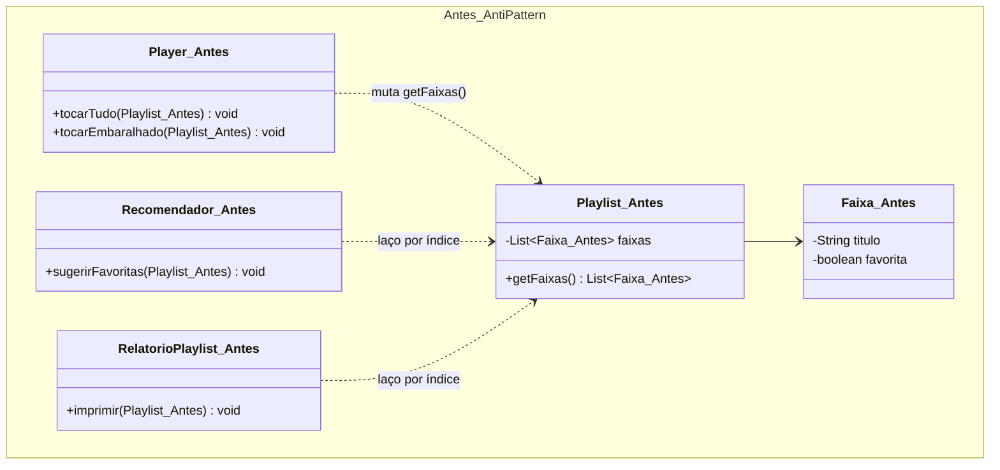
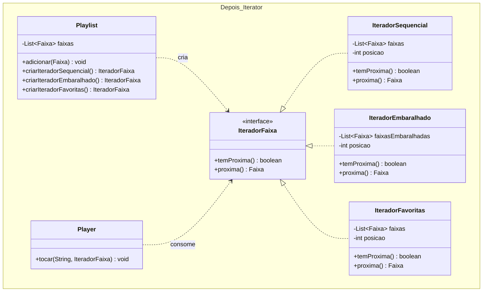

# Atividade 13: Iterator

## Exercício 1: Aplicações

1. **Faz sentido usar Iterator.** O padrão permite oferecer múltiplos objetos iteradores (sequencial, embaralhado, filtrado por favoritas) que encapsulam seus próprios algoritmos e cursores de navegação. Assim, o player consome faixas por uma interface uniforme sem conhecer a lista interna da playlist.
2. **Faz sentido usar Iterator.** Percorrer uma estrutura hierárquica em árvore (como diretórios em profundidade ou largura) envolve estado de navegação complexo (pilhas ou filas internas). O Iterator esconde a topologia de nós e ponteiros da árvore, entregando cada item sequencialmente ao cliente.
3. **Faz sentido usar Iterator.** Em leitura por *streaming*, um iterador pode carregar blocos sob demanda (*lazy loading*) a cada chamada de `proxima()`, mantendo apenas o registro atual em memória. O consumidor percorre o arquivo gigante usando a mesma abstração de uma coleção comum, sem lidar com *buffers* de I/O.
4. **Não faz sentido usar Iterator.** Quando uma estrutura fixa e simples é percorrida apenas internamente pela própria classe que a encapsula, criar interfaces e classes de iteração adiciona complexidade desnecessária (*overengineering*). Um laço `for` nativo resolve a necessidade sem expor a representação interna a terceiros.
5. **Faz sentido usar Iterator.** O cursor de um banco de dados (`ResultSet`) é um exemplo clássico do padrão Iterator: ele fornece acesso sequencial linha a linha enquanto oculta detalhes de rede, paginação de protocolo e estrutura interna da tabela.

---

## Exercício 2: Rastreando o anti-pattern em um projeto real

### Respostas às Questões de Análise

1. **Quebra de encapsulamento em `Playlist.getFaixas()`:** Ao retornar a referência direta para a `List` interna, a classe `Playlist` perde o controle sobre seu próprio estado. Clientes externos (`Player`, `Recomendador` e `RelatorioPlaylist`) passam a depender diretamente da implementação concreta `List` e podem adicionar, remover ou reordenar faixas de forma arbitrária sem que a `Playlist` saiba.
2. **Por que a ordem original mudou após `tocarEmbaralhado`:** O método `tocarEmbaralhado` obteve a referência da lista interna via `playlist.getFaixas()` e aplicou `Collections.shuffle(...)` diretamente sobre ela. Como não foi feita uma cópia isolada nem criado um iterador independente, a mutação alterou permanentemente a ordem das músicas armazenadas dentro do objeto `Playlist`.
3. **Impacto de trocar a estrutura interna:** Os 3 clientes (`Player`, `Recomendador` e `RelatorioPlaylist`) repetem laços baseados em índice (`for` com `size()` e `get(i)`). Se a `Playlist` trocar sua estrutura interna para um conjunto (`Set`), árvore, ou paginação remota sem acesso indexado posicional, **todos os 3 clientes quebrarão** simultaneamente.
4. **Estrutura da refatoração com Iterator:**
   - **Interface de iterador (`IteradorFaixa`):** Declara os métodos `boolean temProxima()` e `Faixa proxima()`.
   - **Iteradores concretos:** `IteradorSequencial`, `IteradorEmbaralhado` (que embaralha uma cópia interna ao ser construído) e `IteradorFavoritas` (que avança internamente até a próxima faixa marcada como favorita).
   - **Agregado (`Playlist`):** Mantém a coleção privada (sem `getFaixas()` público) e expõe métodos fábrica de iteradores: `criarIteradorSequencial()`, `criarIteradorEmbaralhado()` e `criarIteradorFavoritas()`.
5. **Novas formas de travessia:** Para criar uma nova ordem de reprodução, basta implementar uma nova classe de `IteradorFaixa` e expor seu método fábrica na `Playlist`. Os clientes usam sempre o mesmo laço `while (iterador.temProxima())`, sem duplicar filtros ou índices e sem modificar a coleção original.

---

### Diagramas de Classes (Antes e Depois)

#### Antes (Anti-pattern)


#### Depois (Com Iterator)


---

### Código Refatorado (Java 17)

```java
package br.venson.net.designpatterns.iterator;

import java.util.ArrayList;
import java.util.Collections;
import java.util.List;
import java.util.NoSuchElementException;

// Entidade de domínio
class Faixa {
    private final String titulo;
    private final String artista;
    private final boolean favorita;

    public Faixa(String titulo, String artista, boolean favorita) {
        this.titulo = titulo;
        this.artista = artista;
        this.favorita = favorita;
    }

    public String getTitulo() { return titulo; }
    public String getArtista() { return artista; }
    public boolean isFavorita() { return favorita; }

    @Override
    public String toString() {
        return String.format("%s - %s%s", artista, titulo, favorita ? " [★]" : "");
    }
}

// 1. Interface Iterator
public interface IteradorFaixa {
    boolean temProxima();
    Faixa proxima();
}

// 2. Iteradores Concretos
class IteradorSequencial implements IteradorFaixa {
    private final List<Faixa> faixas;
    private int posicao = 0;

    public IteradorSequencial(List<Faixa> faixas) {
        this.faixas = List.copyOf(faixas);
    }

    @Override
    public boolean temProxima() {
        return posicao < faixas.size();
    }

    @Override
    public Faixa proxima() {
        if (!temProxima()) throw new NoSuchElementException("Fim da playlist.");
        return faixas.get(posicao++);
    }
}

class IteradorEmbaralhado implements IteradorFaixa {
    private final List<Faixa> faixasEmbaralhadas;
    private int posicao = 0;

    public IteradorEmbaralhado(List<Faixa> faixasOriginais) {
        // Trabalha sobre uma cópia para preservar a ordem original da Playlist
        this.faixasEmbaralhadas = new ArrayList<>(faixasOriginais);
        Collections.shuffle(this.faixasEmbaralhadas);
    }

    @Override
    public boolean temProxima() {
        return posicao < faixasEmbaralhadas.size();
    }

    @Override
    public Faixa proxima() {
        if (!temProxima()) throw new NoSuchElementException("Fim da playlist embaralhada.");
        return faixasEmbaralhadas.get(posicao++);
    }
}

class IteradorFavoritas implements IteradorFaixa {
    private final List<Faixa> faixas;
    private int posicao = 0;

    public IteradorFavoritas(List<Faixa> faixas) {
        this.faixas = List.copyOf(faixas);
        avancarParaProximaFavorita();
    }

    private void avancarParaProximaFavorita() {
        while (posicao < faixas.size() && !faixas.get(posicao).isFavorita()) {
            posicao++;
        }
    }

    @Override
    public boolean temProxima() {
        return posicao < faixas.size();
    }

    @Override
    public Faixa proxima() {
        if (!temProxima()) throw new NoSuchElementException("Sem mais faixas favoritas.");
        Faixa atual = faixas.get(posicao++);
        avancarParaProximaFavorita();
        return atual;
    }
}

// 3. Agregado (Playlist) - Encapsula a coleção interna
class Playlist {
    private final List<Faixa> faixas = new ArrayList<>();

    public void adicionar(Faixa faixa) {
        faixas.add(faixa);
    }

    public IteradorFaixa criarIteradorSequencial() {
        return new IteradorSequencial(faixas);
    }

    public IteradorFaixa criarIteradorEmbaralhado() {
        return new IteradorEmbaralhado(faixas);
    }

    public IteradorFaixa criarIteradorFavoritas() {
        return new IteradorFavoritas(faixas);
    }
}

// 4. Clientes desacoplados da estrutura interna
class Player {
    public void tocar(String modo, IteradorFaixa iterador) {
        System.out.println("=== Reproduzindo (" + modo + ") ===");
        while (iterador.temProxima()) {
            System.out.println("Tocando: " + iterador.proxima());
        }
        System.out.println();
    }
}

class Main {
    public static void main(String[] args) {
        Playlist playlist = new Playlist();
        playlist.adicionar(new Faixa("Aguas de Marco", "Tom Jobim", true));
        playlist.adicionar(new Faixa("Construcao", "Chico Buarque", false));
        playlist.adicionar(new Faixa("O Mundo e um Moinho", "Cartola", true));
        playlist.adicionar(new Faixa("Roda Viva", "Chico Buarque", false));

        Player player = new Player();
        player.tocar("Ordem Original", playlist.criarIteradorSequencial());
        player.tocar("Modo Embaralhado", playlist.criarIteradorEmbaralhado());
        player.tocar("Apenas Favoritas", playlist.criarIteradorFavoritas());
        // Comprova que a ordem original na Playlist permanece intacta após o shuffle:
        player.tocar("Ordem Original (Intacta)", playlist.criarIteradorSequencial());
    }
}
```

### Justificativa de Design
A remoção do método `getFaixas()` restaurou o encapsulamento da `Playlist`, impedindo que clientes externos dependam de `java.util.List` ou corrompam a ordenação original da coleção ao executar operações como embaralhamento. Ao extrair o cursor e a lógica de filtragem/ordenação para implementações de `IteradorFaixa` (`IteradorSequencial`, `IteradorEmbaralhado` e `IteradorFavoritas`), cumprimos o Princípio da Responsabilidade Única (SRP) e permitimos travessias simultâneas e independentes sobre a mesma playlist sem duplicar laços `for` nos clientes.