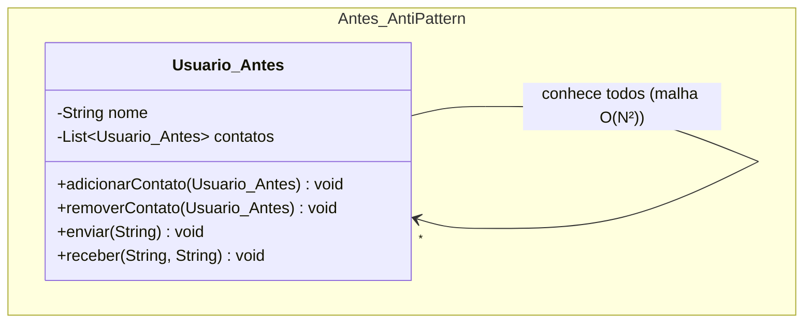
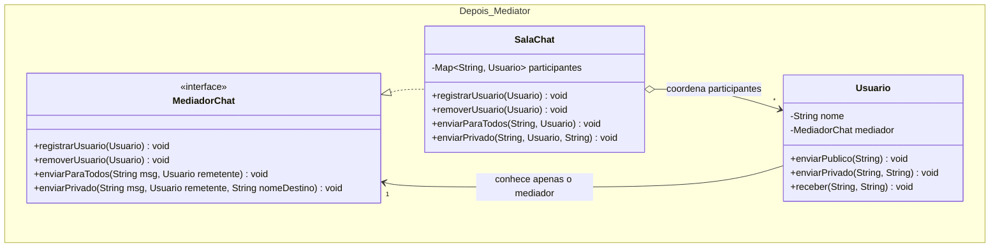

# Atividade 14: Mediator

## Exercício 1: Aplicações

1. **Faz sentido usar Mediator.** Em uma sala de chat com dezenas de participantes, referências diretas entre usuários criariam um grafo completo de dependências difícil de manter. O Mediator centraliza o roteamento de mensagens e as políticas de conversa (privacidade, bloqueios, sons), mantendo os usuários desacoplados entre si.
2. **Faz sentido usar Mediator.** Componentes de interface gráfica (Checkbox, Botão, Campo de texto) que reagem mutuamente formam uma teia de acoplamento se referenciarem uns aos outros diretamente. Usar o diálogo ou controlador como Mediator permite que cada widget apenas notifique eventos ao mediador, que coordena as atualizações visuais em um único lugar.
3. **Faz sentido usar Mediator.** Coordenar múltiplos motoristas, pedidos e regras dinâmicas de despacho exige um ponto central de orquestração. O Mediator evita que pedidos e motoristas mantenham listas de referências cruzadas, concentrando a lógica de alocação na central de despacho.
4. **Não faz sentido usar Mediator.** Quando há apenas dois objetos (`Impressora` e `Spooler`) com uma comunicação direta, unidirecional e estável, não existe malha de dependências para simplificar. Introduzir um mediador intermediário apenas adicionaria indireção desnecessária (*overengineering*).
5. **Não faz sentido usar Mediator.** Uma classe de valor (`Ponto`) que apenas armazena coordenadas e não coordena interações com outros componentes não possui problema de acoplamento colaborativo a ser resolvido pelo padrão.

---

## Exercício 2: Rastreando o anti-pattern em um projeto real

### Respostas às Questões de Análise

1. **Crescimento das ligações e acoplamento:** Para `N` usuários em que cada um guarda referências para todos os demais, existem `N * (N - 1)` referências direcionadas (ou `N * (N - 1) / 2` conexões bidirecionais), caracterizando uma complexidade quadrática `O(N²)`. Isso demonstra acoplamento máximo em malha (topologia todos-para-todos), tornando os objetos difíceis de manter, testar ou reutilizar isoladamente.
2. **Inclusão de novo usuário (`Diego`) e problemas na remoção:**
   - **Para incluir `Diego`:** É necessário instanciar `Diego`, chamar `adicionarContato(diego)` em cada um dos `N` usuários já existentes na sala e chamar `diego.adicionarContato(u)` para cada usuário existente.
   - **Na remoção:** É preciso percorrer manualmente a lista de contatos de todos os demais usuários para remover a referência ao usuário que saiu. Se um único usuário esquecer de remover a referência, ocorrem vazamentos de memória (*memory leaks*) e envio de mensagens para "usuários fantasmas" que já deixaram a conversa.
3. **Localização das regras de conversa:** No código original, a regra de difusão (*broadcast*) está espalhada dentro do próprio método `enviar` de `Usuario`. Essas regras (quem pode falar, mensagens privadas, filtros de moderação) deveriam morar exclusivamente no **Mediador (`SalaChat`)**, pois pertencem ao protocolo da sala e não à identidade do usuário.
4. **Estrutura da refatoração com Mediator:**
   - **Interface de mediador (`MediadorChat`):** Define `registrarUsuario(Usuario)`, `removerUsuario(Usuario)`, `enviarParaTodos(String, Usuario)` e `enviarPrivado(String, Usuario, String)`.
   - **Mediador concreto (`SalaChat`):** Mantém a coleção de participantes ativos e implementa as regras de entrega de mensagens.
   - **Colegas (`Usuario`):** Guardam apenas uma única referência para `MediadorChat`, delegando todo envio ao mediador.
5. **Vantagens após refatorar:** Incluir ou remover alguém resume-se a uma única chamada (`sala.registrarUsuario(diego)` ou `sala.removerUsuario(diego)`), reduzindo a complexidade de conexões de `O(N²)` para `O(N)`. Além disso, a mesma classe `Usuario` pode ser reutilizada em uma `SalaChatModerada` ou `ChatSuportePrivado` apenas injetando outro `MediadorChat`.

---

### Diagramas de Classes (Antes e Depois)

#### Antes (Anti-pattern)


#### Depois (Com Mediator)


---

### Código Refatorado (Java 17)

```java
package br.venson.net.designpatterns.mediator;

import java.util.LinkedHashMap;
import java.util.Map;

// 1. Interface Mediator
public interface MediadorChat {
    void registrarUsuario(Usuario usuario);
    void removerUsuario(Usuario usuario);
    void enviarParaTodos(String mensagem, Usuario remetente);
    void enviarPrivado(String mensagem, Usuario remetente, String nomeDestinatario);
}

// 2. Mediador Concreto
class SalaChat implements MediadorChat {
    private final Map<String, Usuario> participantes = new LinkedHashMap<>();

    @Override
    public void registrarUsuario(Usuario usuario) {
        participantes.put(usuario.getNome(), usuario);
        usuario.setMediador(this);
        System.out.println("[Sala] " + usuario.getNome() + " entrou na sala.");
    }

    @Override
    public void removerUsuario(Usuario usuario) {
        if (participantes.remove(usuario.getNome()) != null) {
            usuario.setMediador(null);
            System.out.println("[Sala] " + usuario.getNome() + " saiu da sala.");
        }
    }

    @Override
    public void enviarParaTodos(String mensagem, Usuario remetente) {
        if (!participantes.containsKey(remetente.getNome())) {
            System.out.println("[Erro] " + remetente.getNome() + " não está ativo na sala.");
            return;
        }
        for (Usuario destino : participantes.values()) {
            if (!destino.equals(remetente)) {
                destino.receber(mensagem, remetente.getNome() + " (público)");
            }
        }
    }

    @Override
    public void enviarPrivado(String mensagem, Usuario remetente, String nomeDestinatario) {
        Usuario destino = participantes.get(nomeDestinatario);
        if (destino != null && !destino.equals(remetente)) {
            destino.receber(mensagem, remetente.getNome() + " (privado)");
        } else {
            System.out.println("[Sala] Destinatário '" + nomeDestinatario + "' não encontrado.");
        }
    }
}

// 3. Colega (Usuario) - Desacoplado dos demais usuários
class Usuario {
    private final String nome;
    private MediadorChat mediador;

    public Usuario(String nome) {
        this.nome = nome;
    }

    public String getNome() {
        return nome;
    }

    public void setMediador(MediadorChat mediador) {
        this.mediador = mediador;
    }

    public void enviarPublico(String mensagem) {
        if (mediador != null) {
            mediador.enviarParaTodos(mensagem, this);
        }
    }

    public void enviarPrivado(String mensagem, String destinatario) {
        if (mediador != null) {
            mediador.enviarPrivado(mensagem, this, destinatario);
        }
    }

    public void receber(String mensagem, String origem) {
        System.out.printf("[%s recebeu de %s]: %s%n", nome, origem, mensagem);
    }
}

class Main {
    public static void main(String[] args) {
        MediadorChat sala = new SalaChat();

        Usuario ana = new Usuario("Ana");
        Usuario bruno = new Usuario("Bruno");
        Usuario carla = new Usuario("Carla");
        Usuario diego = new Usuario("Diego");

        sala.registrarUsuario(ana);
        sala.registrarUsuario(bruno);
        sala.registrarUsuario(carla);

        ana.enviarPublico("Olá, pessoal!");

        // Inclusão simples sem tocar nos objetos existentes
        sala.registrarUsuario(diego);
        diego.enviarPrivado("Oi Ana, tudo bem?", "Ana");

        // Remoção centralizada e segura
        sala.removerUsuario(bruno);
        carla.enviarPublico("Bruno já saiu?");
    }
}
```

### Justificativa de Design
A introdução da interface `MediadorChat` e da classe concreta `SalaChat` converteu uma topologia em malha (`O(N²)` referências diretas entre usuários) em uma topologia em estrela (`O(N)`), na qual cada `Usuario` conhece apenas o mediador. Essa decisão elimina a manutenção manual de listas de contatos a cada entrada ou saída de participante, evita referências órfãs a usuários desconectados e concentra todas as políticas de roteamento (mensagens públicas, privadas e validação de presença) em uma única classe coesa.