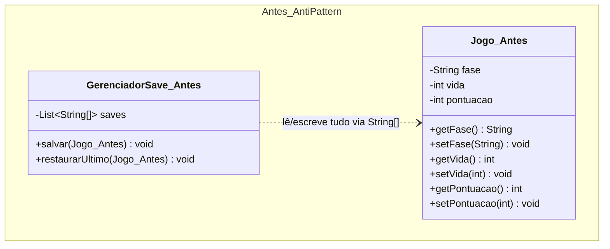
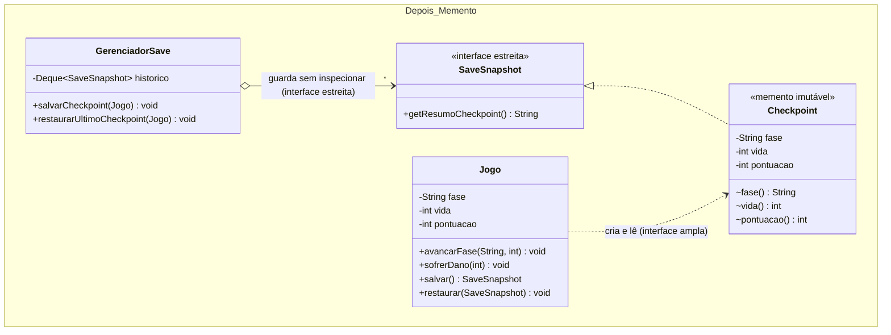

# Atividade 16: Memento

## Exercício 1: Aplicações

1. **Faz sentido usar Memento.** O sistema de *checkpoints* precisa capturar e restaurar o estado interno da partida (fase, vida, pontos) sem que o gerenciador de saves acesse ou modifique diretamente os atributos privados do jogo. O Memento preserva o encapsulamento do *Originator*.
2. **Faz sentido usar Memento.** Em um editor de texto, salvar instantâneos (*snapshots*) imutáveis do documento antes de cada alteração permite implementar desfazer/refazer com segurança, restaurando exatamente o texto, posição do cursor e formatação anteriores.
3. **Faz sentido usar Memento.** Em um assistente (*wizard*) de múltiplos passos, empilhar mementos a cada avanço permite que o botão "Voltar" reverta o estado exato dos campos da etapa anterior sem espalhar lógica manual de cópia de atributos pela interface.
4. **Não faz sentido usar Memento.** Uma classe de configuração lida apenas na inicialização não possui histórico temporal nem requisito de reversão (*rollback*). Criar objetos de snapshot seria *overengineering*.
5. **Não faz sentido usar Memento.** Uma classe `Ponto` simples sem necessidade de histórico de estados passados não precisa da infraestrutura de *Originator*, *Memento* e *Caretaker*.

---

## Exercício 2: Rastreando o anti-pattern em um projeto real

### Respostas às Questões de Análise

1. **Quebra de encapsulamento em `Jogo`:** Ao expor *getters* e *setters* públicos para todos os atributos internos (`setVida`, `setPontuacao`, `setFase`), qualquer classe externa pode alterar arbitrariamente o estado do jogo a qualquer instante (por exemplo, atribuindo vida negativa ou pulando fases sem validação), destruindo as invariantes de negócio da classe `Jogo`.
2. **Impacto de novo atributo (`inimigos`) no `GerenciadorSave`:** Seria necessário alterar pelo menos **4 pontos críticos**: a classe `Jogo` (novo atributo, getter e setter), o tamanho e a montagem do array `String[]` no método de salvamento do `GerenciadorSave`, e o índice de leitura e conversão (`Integer.parseInt` ou similar) no método de restauração do `GerenciadorSave`. Isso revela acoplamento estrutural íntimo (*Inappropriate Intimacy*) entre o gerenciador e os detalhes internos do jogo.
3. **Riscos de usar `String[]` sem tipagem:** Converter atributos tipados (`int`, `String`, etc.) para um vetor posicional de strings elimina a verificação de tipos em tempo de compilação. Trocar acidentalmente a ordem de dois índices (`dados[1]` por `dados[2]`) ou formatar um número incorretamente gera `NumberFormatException`, `ArrayIndexOutOfBoundsException` ou corrupção silenciosa de dados (ex.: atribuir a pontuação no campo de vida).
4. **Estrutura da refatoração com Memento:**
   - **Interface estreita (`SaveSnapshot`):** Interface pública sem métodos de acesso aos dados internos (ou apenas metadados de exibição, como resumo do checkpoint), vista pelo *Caretaker*.
   - **Memento concreto (`Checkpoint`):** Classe imutável (`record` privado interno a `Jogo`) que armazena `fase`, `vida` e `pontuacao` com seus tipos reais (interface ampla acessível apenas pelo `Jogo`).
   - **Originator (`Jogo`):** Encapsula seus atributos (sem *setters* públicos irrestritos), cria o snapshot em `salvar()` e restaura seu estado em `restaurar(SaveSnapshot)`.
   - **Caretaker (`GerenciadorSave`):** Mantém uma pilha (`Deque<SaveSnapshot>`) de snapshots opacos, sem conhecer nem converter os campos internos.
5. **Benefícios após refatorar:** Se `Jogo` ganhar o atributo `inimigosRestantes`, apenas `Jogo` e `Checkpoint` são atualizados; o `GerenciadorSave` permanece **100% inalterado**. Além disso, todos os campos mantêm seus tipos nativos (`int`, `String`) em objetos imutáveis, eliminando conversões manuais e erros posicionais.

---

### Diagramas de Classes (Antes e Depois)

#### Antes (Anti-pattern)


#### Depois (Com Memento)


---

### Código Refatorado (Java 17)

```java
package br.venson.net.designpatterns.memento;

import java.util.ArrayDeque;
import java.util.Deque;

// 1. Interface Estreita (visível para o Caretaker / GerenciadorSave)
public interface SaveSnapshot {
    String getResumoCheckpoint();
}

// 2. Originator (Jogo) com Memento encapsulado
class Jogo {
    private String fase;
    private int vida;
    private int pontuacao;

    public Jogo(String faseInicial, int vidaInicial, int pontuacaoInicial) {
        this.fase = faseInicial;
        this.vida = vidaInicial;
        this.pontuacao = pontuacaoInicial;
    }

    // Métodos de domínio controlados (sem setters livres que quebrem invariantes)
    public void avancarFase(String novaFase, int pontosGanhos) {
        this.fase = novaFase;
        this.pontuacao += pontosGanhos;
    }

    public void sofrerDano(int dano) {
        this.vida = Math.max(0, this.vida - dano);
    }

    public SaveSnapshot salvar() {
        return new Checkpoint(this.fase, this.vida, this.pontuacao);
    }

    public void restaurar(SaveSnapshot snapshot) {
        if (!(snapshot instanceof Checkpoint cp)) {
            throw new IllegalArgumentException("Snapshot inválido para este jogo.");
        }
        this.fase = cp.fase;
        this.vida = cp.vida;
        this.pontuacao = cp.pontuacao;
    }

    @Override
    public String toString() {
        return String.format("Jogo [Fase='%s', Vida=%d, Pontos=%d]", fase, vida, pontuacao);
    }

    // Memento Concreto Imutável: privado ao Originator (Interface Ampla exclusiva de Jogo)
    private record Checkpoint(String fase, int vida, int pontuacao) implements SaveSnapshot {
        @Override
        public String getResumoCheckpoint() {
            return "Checkpoint na fase: " + fase;
        }
    }
}

// 3. Caretaker (GerenciadorSave) - Depende apenas da Interface Estreita
class GerenciadorSave {
    private final Deque<SaveSnapshot> historico = new ArrayDeque<>();

    public void salvarCheckpoint(Jogo jogo) {
        SaveSnapshot snapshot = jogo.salvar();
        historico.push(snapshot);
        System.out.println("[Save] Salvo -> " + snapshot.getResumoCheckpoint());
    }

    public void restaurarUltimoCheckpoint(Jogo jogo) {
        if (historico.isEmpty()) {
            System.out.println("[Save] Nenhum checkpoint disponível.");
            return;
        }
        SaveSnapshot ultimo = historico.pop();
        jogo.restaurar(ultimo);
        System.out.println("[Save] Restaurado <- " + ultimo.getResumoCheckpoint());
    }
}

class Main {
    public static void main(String[] args) {
        Jogo jogo = new Jogo("Floresta Sombria", 100, 0);
        GerenciadorSave gerenciador = new GerenciadorSave();

        System.out.println("Estado inicial: " + jogo);
        gerenciador.salvarCheckpoint(jogo);

        jogo.avancarFase("Caverna de Lava", 250);
        jogo.sofrerDano(40);
        System.out.println("Após explorar : " + jogo);
        gerenciador.salvarCheckpoint(jogo);

        jogo.avancarFase("Castelo do Chefe", 500);
        jogo.sofrerDano(60); // Vida chega a 0
        System.out.println("Derrotado     : " + jogo);

        // Restaurando para o checkpoint anterior com segurança de tipos
        gerenciador.restaurarUltimoCheckpoint(jogo);
        System.out.println("Após restaurar: " + jogo);
    }
}
```

### Justificativa de Design
A refatoração eliminou a exposição pública dos atributos mutáveis de `Jogo` e substituiu o frágil array `String[]` por um `record` imutável privado (`Checkpoint`) que implementa a interface estreita `SaveSnapshot`. Dessa forma, o `GerenciadorSave` (*Caretaker*) armazena e empilha os estados sem conhecer nem converter nenhum atributo interno do jogo, enquanto o `Jogo` (*Originator*) tem acesso exclusivo à interface ampla do `Checkpoint` para restaurar seus campos com segurança de tipos em tempo de compilação.