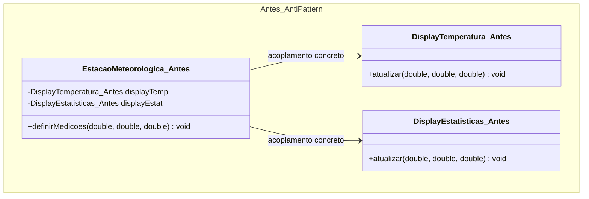
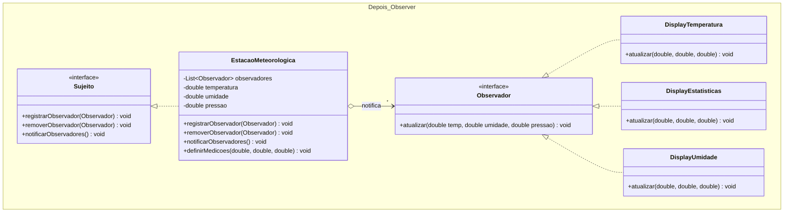

# Atividade 15: Observer

## Exercício 1: Aplicações

1. **Faz sentido usar Observer.** A estação meteorológica atua como sujeito (*Subject*) que produz dados, enquanto um número variável de painéis atua como observadores (*Observers*). O padrão permite atualizar todos os displays automaticamente a cada nova medição sem acoplar a estação às classes concretas de visualização.
2. **Faz sentido usar Observer.** Em arquiteturas MVC e eventos de UI, o modelo e os botões precisam notificar múltiplos *listeners* sobre mudanças de estado ou cliques sem conhecer suas implementações concretas. O Observer fundamenta esse mecanismo de publicação-assinatura desacoplado.
3. **Faz sentido usar Observer.** Uma newsletter possui uma relação um-para-muitos dinâmica, em que leitores assinam ou cancelam o recebimento a qualquer momento. O padrão gerencia essa lista de inscritos e dispara notificações automáticas a cada nova edição publicada.
4. **Não faz sentido usar Observer.** Se o valor de configuração é lido uma única vez de forma síncrona por um único consumidor fixo, não há eventos de mudança de estado nem múltiplos interessados. Criar infraestrutura de assinatura e notificação seria *overengineering*.
5. **Não faz sentido usar Observer.** Um objeto `Ponto` passivo, sem requisito de propagar alterações de estado para dependentes externos, não se beneficia de listas de observadores.

---

## Exercício 2: Rastreando o anti-pattern em um projeto real

### Respostas às Questões de Análise

1. **Por que há acoplamento forte entre sujeito e observadores:** A `EstacaoMeteorologica` declara atributos explícitos dos tipos concretos `DisplayTemperatura` e `DisplayEstatisticas` e invoca seus métodos diretamente dentro de `definirMedicoes(...)`. Assim, a camada de domínio/sensores conhece detalhes de implementação da camada visual.
2. **Alterações necessárias para incluir `DisplayUmidade`:** Seria obrigatório modificar o código-fonte de `EstacaoMeteorologica.java` em **3 pontos**:
   - Adicionar um novo atributo privado `private DisplayUmidade displayUmidade;`;
   - Alterar o construtor (ou criar um *setter*) na estação para receber a instância de `DisplayUmidade`;
   - Adicionar a chamada `displayUmidade.atualizar(...)` dentro do método de atualização de medições, violando o Princípio Aberto-Fechado (OCP).
3. **Impossibilidade de registro em runtime:** Como os displays estão fixados em variáveis de instância estaticamente tipadas no construtor da estação, não existe uma coleção dinâmica nem métodos de inscrição (`registrar`/`remover`). Para permitir isso, faltam uma interface comum (`Observador`) e uma lista polimórfica (`List<Observador>`) gerenciada pelo sujeito.
4. **Estrutura da refatoração com Observer:**
   - **Interface `Observador`:** Declara `atualizar(double temperatura, double umidade, double pressao)`.
   - **Interface `Sujeito`:** Declara `registrarObservador(Observador)`, `removerObservador(Observador)` e `notificarObservadores()`.
   - **Sujeito concreto (`EstacaoMeteorologica`):** Mantém uma `List<Observador>` e percorre a lista quando novas medições chegam.
   - **Observadores concretos:** `DisplayTemperatura`, `DisplayEstatisticas` e `DisplayUmidade`, implementando `Observador`.
5. **Facilidade de extensão e reuso:** Adicionar um novo display exige apenas criar a nova classe implementando `Observador` e registrá-la via `estacao.registrarObservador(novoDisplay)`, sem tocar ou recompilar a `EstacaoMeteorologica`. A estação torna-se 100% reutilizável em qualquer aplicação (console, web, mobile).

---

### Diagramas de Classes (Antes e Depois)

#### Antes (Anti-pattern)


#### Depois (Com Observer)


---

### Código Refatorado (Java 17)

```java
package br.venson.net.designpatterns.observer;

import java.util.ArrayList;
import java.util.List;

// 1. Interface Observer
public interface Observador {
    void atualizar(double temperatura, double umidade, double pressao);
}

// 2. Interface Subject
interface Sujeito {
    void registrarObservador(Observador o);
    void removerObservador(Observador o);
    void notificarObservadores();
}

// 3. Sujeito Concreto
class EstacaoMeteorologica implements Sujeito {
    private final List<Observador> observadores = new ArrayList<>();
    private double temperatura;
    private double umidade;
    private double pressao;

    @Override
    public void registrarObservador(Observador o) {
        if (o != null && !observadores.contains(o)) {
            observadores.add(o);
        }
    }

    @Override
    public void removerObservador(Observador o) {
        observadores.remove(o);
    }

    @Override
    public void notificarObservadores() {
        for (Observador obs : observadores) {
            obs.atualizar(temperatura, umidade, pressao);
        }
    }

    public void definirMedicoes(double temperatura, double umidade, double pressao) {
        this.temperatura = temperatura;
        this.umidade = umidade;
        this.pressao = pressao;
        System.out.println("\n--- Nova medição capturada pela Estação ---");
        notificarObservadores();
    }
}

// 4. Observadores Concretos
class DisplayTemperatura implements Observador {
    @Override
    public void atualizar(double temperatura, double umidade, double pressao) {
        System.out.printf("[Display Temperatura] Atual: %.1f °C%n", temperatura);
    }
}

class DisplayEstatisticas implements Observador {
    private double somaTemp = 0;
    private int leituras = 0;

    @Override
    public void atualizar(double temperatura, double umidade, double pressao) {
        somaTemp += temperatura;
        leituras++;
        System.out.printf("[Display Estatísticas] Média Temp: %.1f °C (%d leituras)%n",
                (somaTemp / leituras), leituras);
    }
}

class DisplayUmidade implements Observador {
    @Override
    public void atualizar(double temperatura, double umidade, double pressao) {
        System.out.printf("[Display Umidade] Umidade Relativa: %.1f%%%n", umidade);
    }
}

class Main {
    public static void main(String[] args) {
        EstacaoMeteorologica estacao = new EstacaoMeteorologica();

        Observador displayTemp = new DisplayTemperatura();
        Observador displayEstat = new DisplayEstatisticas();
        Observador displayUmid = new DisplayUmidade();

        // Assinatura dinâmica em tempo de execução
        estacao.registrarObservador(displayTemp);
        estacao.registrarObservador(displayEstat);
        estacao.definirMedicoes(26.5, 65.0, 1013.2);

        // Adicionando novo display em runtime sem alterar a Estação
        estacao.registrarObservador(displayUmid);
        estacao.definirMedicoes(28.0, 70.0, 1011.8);

        // Removendo um display em runtime
        estacao.removerObservador(displayTemp);
        estacao.definirMedicoes(24.5, 80.0, 1009.5);
    }
}
```

### Justificativa de Design
Ao substituir as referências concretas por uma lista polimórfica de `Observador` gerenciada pela interface `Sujeito`, invertemos o acoplamento entre a fonte de dados e as visualizações (Princípio da Inversão de Dependência - DIP). Agora a `EstacaoMeteorologica` desconhece quantos ou quais painéis estão ouvindo suas atualizações, permitindo anexar novos displays (como `DisplayUmidade`) ou desativar existentes em tempo de execução sem alterar uma única linha da estação (OCP).