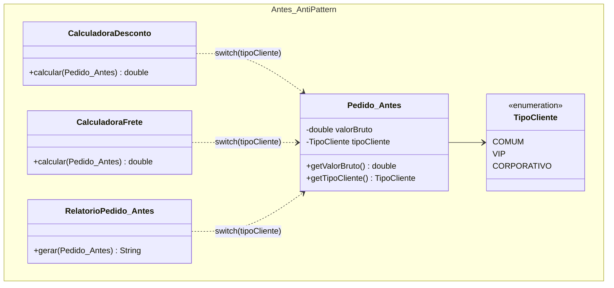
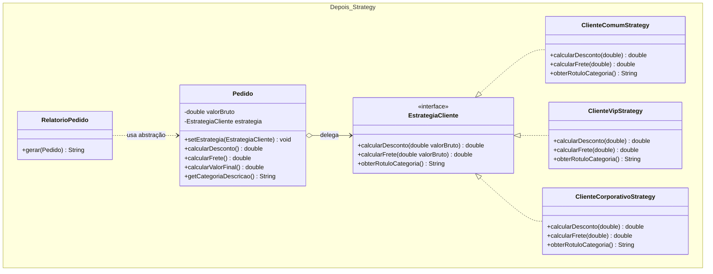

# Atividade 12: Strategy

## Exercício 1: Aplicações

1. **Faz sentido usar Strategy.** O cálculo de frete possui uma família de algoritmos intercambiáveis (Sedex, PAC, Retirada) que compartilham o mesmo objetivo. Encapsular cada modalidade em uma estratégia permite selecionar o cálculo em tempo de execução e adicionar novas transportadoras respeitando o Princípio Aberto-Fechado (OCP), sem modificar a classe `Checkout`.
2. **Faz sentido usar Strategy.** Pix, cartão e boleto representam variações comportamentais de um mesmo processo de pagamento escolhidas dinamicamente pelo usuário em *runtime*. O padrão isola as regras específicas de cada meio de pagamento em classes dedicadas, evitando estruturas condicionais extensas no processador de pedidos.
3. **Faz sentido usar Strategy.** As fórmulas de dano (bruto, crítico, à distância) constituem algoritmos distintos que podem ser trocados livremente durante a partida sem alterar o fluxo principal do turno de combate. Compor o personagem ou ataque com uma interface de cálculo de dano permite combinar e alternar comportamentos em tempo de execução.
4. **Não faz sentido usar Strategy.** Como a geração do PDF possui um algoritmo único, fixo e sem previsão de variações de formato ou comportamento, criar interfaces e múltiplas classes introduziria complexidade desnecessária (*overengineering*). Um método direto na classe `Relatorio` resolve o problema com clareza.
5. **Não faz sentido usar Strategy.** A soma de coordenadas cartesianas `x` e `y` é uma operação matemática elementar, única e estável. Aplicar o padrão Strategy em uma entidade simples sem algoritmos alternativos apenas fragmentaria o código sem trazer ganho arquitetural.

---

## Exercício 2: Rastreando o anti-pattern em um projeto real

### Respostas às Questões de Análise

1. **Localização das decisões e diagnóstico de design:** As decisões baseadas em `TipoCliente` (`COMUM`, `VIP`, `CORPORATIVO`) se repetem em **3 classes distintas**: `CalculadoraDesconto`, `CalculadoraFrete` e `RelatorioPedido` (além da orquestração no `Pedido`/`Main`). Isso configura o *code smell* **Switch Statements** (condicionais duplicadas espalhadas pelo sistema), indicando forte acoplamento ao enum `TipoCliente`, baixa coesão e violação direta do Princípio Aberto-Fechado (OCP) e do Princípio da Responsabilidade Única (SRP).
2. **Impacto de adicionar o tipo `PARCEIRO`:** Seria necessário editar pelo menos **4 arquivos centrais** (além da classe `Main` para testes):
   - `TipoCliente.java` (inclusão da constante `PARCEIRO` no enum);
   - `CalculadoraDesconto.java` (novo `case PARCEIRO` com a regra de percentual);
   - `CalculadoraFrete.java` (novo `case PARCEIRO` com a regra de taxa de entrega);
   - `RelatorioPedido.java` (novo `case PARCEIRO` com o rótulo/formatação do relatório).
3. **Dificuldade de teste isolado:** As regras de todos os perfis de clientes estão misturadas dentro dos mesmos métodos condicionais. Não é possível testar ou simular (*mockar*) a política de um cliente `VIP` sem carregar o código de `COMUM` e `CORPORATIVO`, e um erro de sintaxe ou lógica em um ramo do `switch` pode quebrar o comportamento dos demais tipos.
4. **Estrutura da refatoração com Strategy:**
   - **Interface de estratégia (`EstrategiaCliente`):** Define o contrato unificado para regras variáveis: `calcularDesconto(double valorBruto)`, `calcularFrete(double valorBruto)` e `obterRotuloCategoria()`.
   - **Estratégias concretas:** `ClienteComumStrategy`, `ClienteVipStrategy` e `ClienteCorporativoStrategy`, cada uma encapsulando de ponta a ponta as regras do respectivo perfil.
   - **Contexto (`Pedido`):** Guarda uma referência para `EstrategiaCliente` e delega a ela os cálculos de desconto, frete e identificação da categoria, sem usar `switch` ou `if/else`.
   - **Desacoplamento de `RelatorioPedido`:** A classe deixa de inspecionar o enum `TipoCliente` e passa a consultar apenas os métodos delegados pelo `Pedido` (que consome a abstração `EstrategiaCliente`).
5. **Troca de comportamento em runtime:** Como o `Pedido` mantém uma referência mutável para a interface `EstrategiaCliente`, basta invocar `pedido.setEstrategia(...)` a qualquer momento para alterar o comportamento do objeto em memória, sem recriar o pedido.

---

### Diagramas de Classes (Antes e Depois)

#### Antes (Anti-pattern)


#### Depois (Com Strategy)


---

### Código Refatorado (Java 17)

```java
package br.venson.net.designpatterns.strategy;

// 1. Interface Strategy
public interface EstrategiaCliente {
    double calcularDesconto(double valorBruto);
    double calcularFrete(double valorBruto);
    String obterRotuloCategoria();
}

// 2. Estratégias Concretas
class ClienteComumStrategy implements EstrategiaCliente {
    @Override
    public double calcularDesconto(double valorBruto) {
        return 0.0;
    }

    @Override
    public double calcularFrete(double valorBruto) {
        return 25.0;
    }

    @Override
    public String obterRotuloCategoria() {
        return "Cliente Comum (Padrão)";
    }
}

class ClienteVipStrategy implements EstrategiaCliente {
    @Override
    public double calcularDesconto(double valorBruto) {
        return valorBruto * 0.10;
    }

    @Override
    public double calcularFrete(double valorBruto) {
        return 0.0;
    }

    @Override
    public String obterRotuloCategoria() {
        return "Cliente VIP (Benefício Premium)";
    }
}

class ClienteCorporativoStrategy implements EstrategiaCliente {
    @Override
    public double calcularDesconto(double valorBruto) {
        return valorBruto * 0.15;
    }

    @Override
    public double calcularFrete(double valorBruto) {
        return valorBruto * 0.05;
    }

    @Override
    public String obterRotuloCategoria() {
        return "Cliente Corporativo (Contrato B2B)";
    }
}

class RegraPromocionalRelampagoStrategy implements EstrategiaCliente {
    @Override
    public double calcularDesconto(double valorBruto) {
        return valorBruto * 0.25;
    }

    @Override
    public double calcularFrete(double valorBruto) {
        return 10.0;
    }

    @Override
    public String obterRotuloCategoria() {
        return "Promoção Relâmpago (25% OFF)";
    }
}

// 3. Contexto (Pedido)
class Pedido {
    private final double valorBruto;
    private EstrategiaCliente estrategia;

    public Pedido(double valorBruto, EstrategiaCliente estrategia) {
        this.valorBruto = valorBruto;
        this.estrategia = estrategia;
    }

    public void setEstrategia(EstrategiaCliente novaEstrategia) {
        this.estrategia = novaEstrategia;
    }

    public double getValorBruto() {
        return valorBruto;
    }

    public double calcularDesconto() {
        return estrategia.calcularDesconto(valorBruto);
    }

    public double calcularFrete() {
        return estrategia.calcularFrete(valorBruto);
    }

    public double calcularValorFinal() {
        return valorBruto - calcularDesconto() + calcularFrete();
    }

    public String getCategoriaDescricao() {
        return estrategia.obterRotuloCategoria();
    }
}

// 4. Gerador de Relatório desacoplado de condicionais
class RelatorioPedido {
    public String gerar(Pedido pedido) {
        return String.format(
            "=== RELATÓRIO DO PEDIDO ===%n" +
            "Categoria : %s%n" +
            "Valor Base: R$ %.2f%n" +
            "Desconto  : R$ %.2f%n" +
            "Frete     : R$ %.2f%n" +
            "Total     : R$ %.2f%n",
            pedido.getCategoriaDescricao(),
            pedido.getValorBruto(),
            pedido.calcularDesconto(),
            pedido.calcularFrete(),
            pedido.calcularValorFinal()
        );
    }
}

// 5. Classe Principal (Demonstração e troca em runtime)
class Main {
    public static void main(String[] args) {
        RelatorioPedido relatorio = new RelatorioPedido();

        Pedido pedido = new Pedido(500.00, new ClienteComumStrategy());
        System.out.println(relatorio.gerar(pedido));

        // Troca em runtime: aplicando regra promocional temporária
        pedido.setEstrategia(new RegraPromocionalRelampagoStrategy());
        System.out.println(relatorio.gerar(pedido));

        // Troca em runtime: voltando ou fazendo upgrade para VIP
        pedido.setEstrategia(new ClienteVipStrategy());
        System.out.println(relatorio.gerar(pedido));
    }
}
```

### Justificativa de Design
A refatoração substituiu o enum `TipoCliente` e as múltiplas instruções `switch` espalhadas pelo sistema por uma hierarquia polimórfica centrada na interface `EstrategiaCliente`. Essa decisão concentra todas as regras de negócio de uma categoria de cliente em sua própria classe concreta, elevando a coesão (SRP) e permitindo que novos perfis (como `ClienteParceiroStrategy`) sejam adicionados como novas classes sem modificar nenhuma linha de `Pedido` ou `RelatorioPedido` (OCP). Além disso, a composição por referência no contexto `Pedido` viabiliza testes unitários isolados para cada regra matemática e permite substituir a política de preços em tempo de execução.